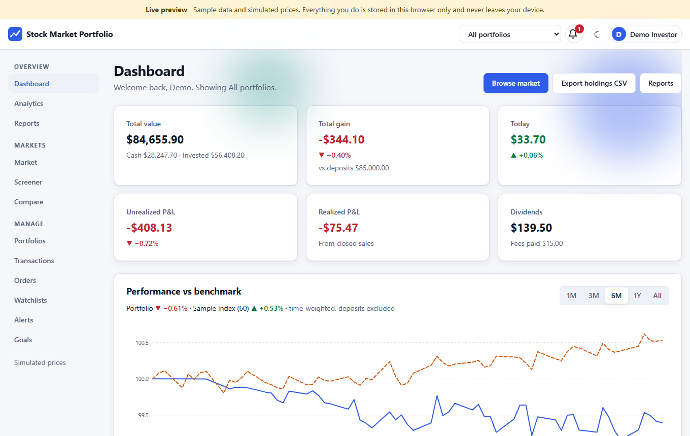
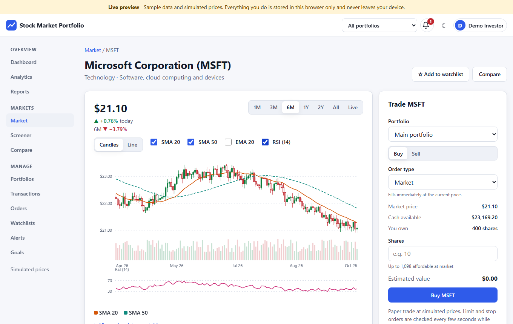
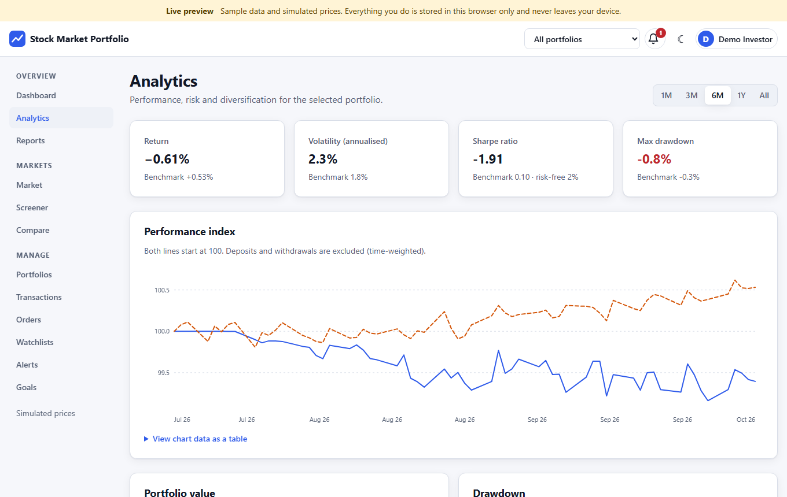
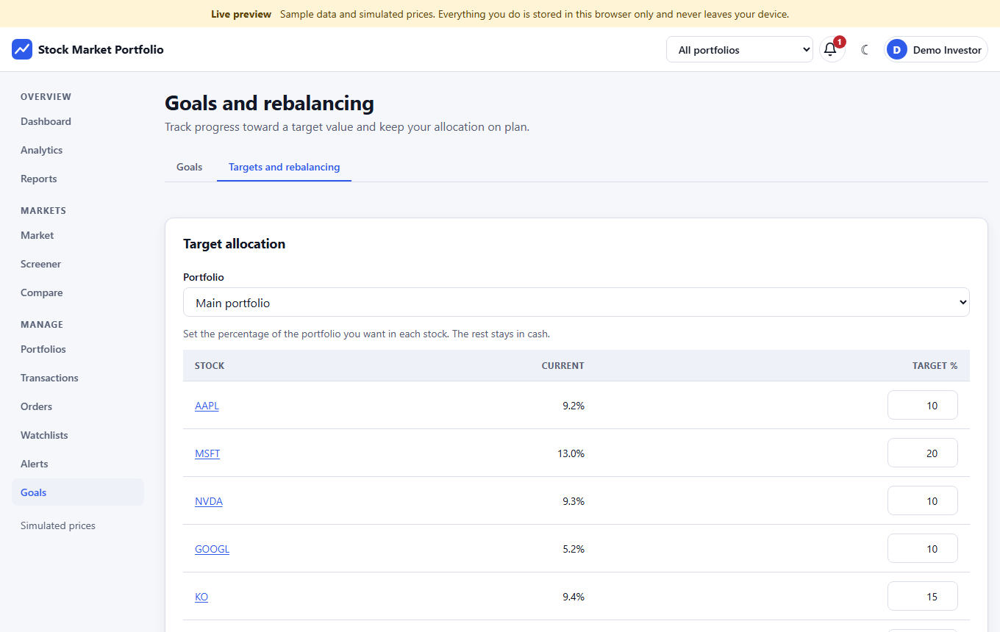
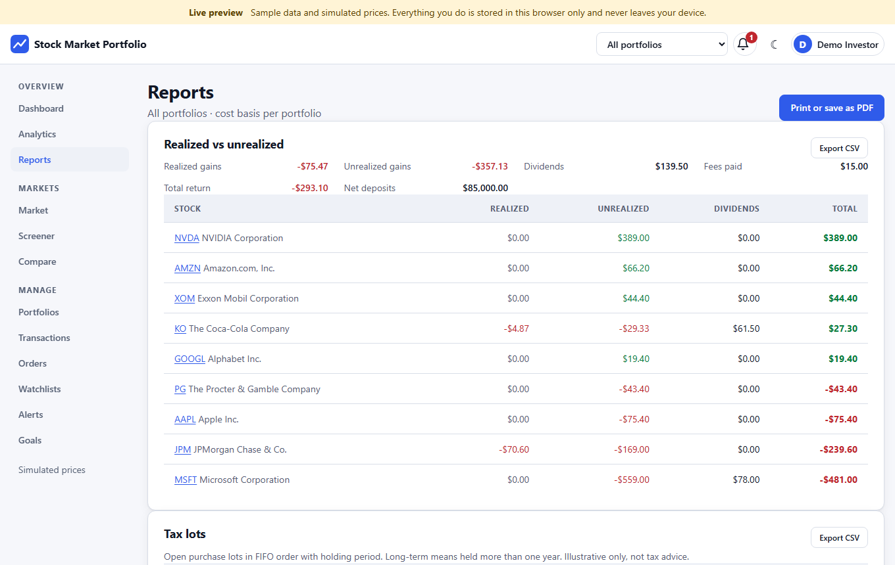
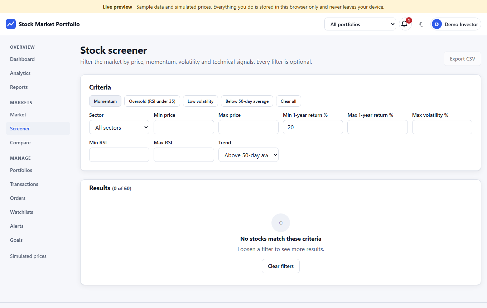
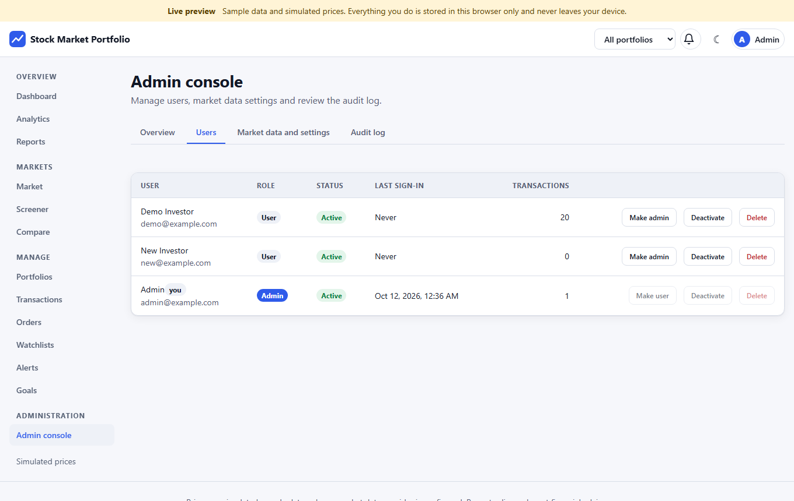
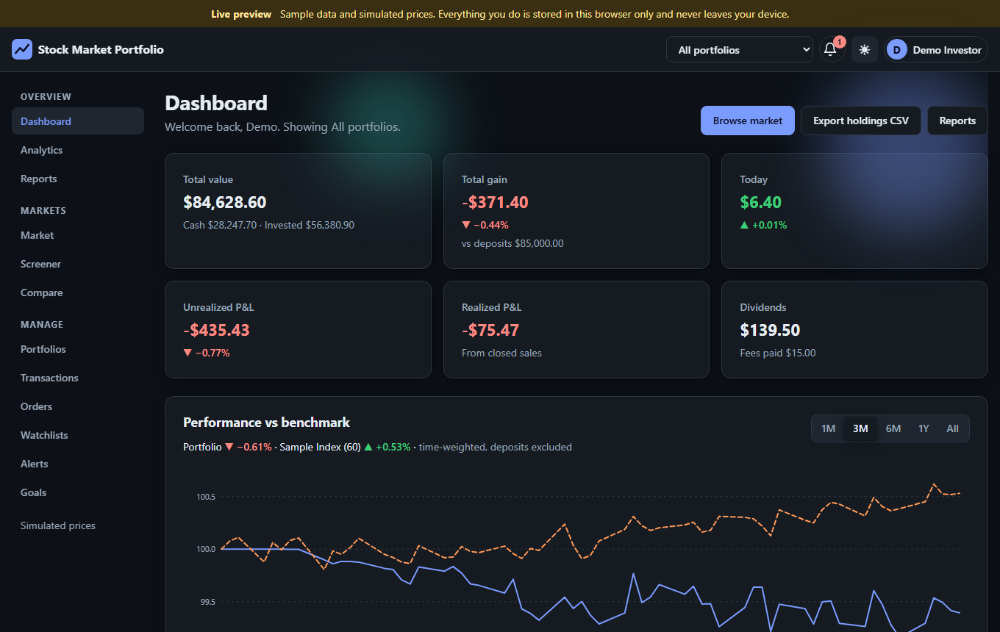
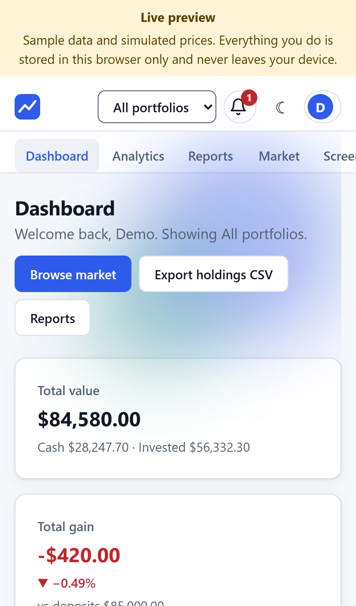

# Stock Market Portfolio

**Live preview:** https://shishir19999.github.io/Stock-Market-Portfolio/ (runs entirely in your browser, no keys, no server)

A portfolio and trading tracker: multiple portfolios with FIFO or average cost basis, realized and unrealized P&L, dividends, allocation, performance against a benchmark, risk metrics, candlestick charts with indicators, paper trading with market, limit and stop orders, a screener, goals with rebalancing suggestions, price alerts with notifications, printable reports, and an admin console. Prices are simulated sample data, paper trading only, not financial advice.

**Stack:** React 19 + Vite 8 (Frontend), Express 5 + Mongoose 9 + JWT (Backend), MongoDB. Finance maths, validation and the account rules live in `shared/` and are used by both the API and the browser-only live preview, so both modes behave the same.



## Screenshots
| | |
|---|---|
|  |  |
|  |  |
|  |  |
|  |  |

## Features
- **Dashboard:** total value, total gain, today, unrealized and realized P&L, dividends and fees; performance line chart against a benchmark with a range selector (1M to All); allocation donut by holding, sector or asset class; sortable holdings with weights; open orders, recent transactions, watchlist movers and goal progress.
- **Multiple portfolios:** separate cash and cost basis method per portfolio (FIFO or average cost), a portfolio switcher in the header ("All portfolios" merges them), deposits and withdrawals.
- **Transactions:** buy, sell, dividend, deposit, withdraw with search, type tabs, symbol and date filters, sorting, pagination, CSV export (respects filters) and CSV import (file or paste, validated as a whole with line-by-line errors, template download).
- **Cost basis and tax lots:** FIFO or average cost, realized vs unrealized by stock, open tax lots with long/short-term holding period, realized sales, dividends, fees, and a printable report (`Reports`, print or save as PDF) with CSV export for each table.
- **Analytics:** time-weighted performance vs the Sample Index (deposits do not distort returns), portfolio value, drawdown chart, volatility, Sharpe ratio, max drawdown, beta, best and worst day, CAGR, sector concentration.
- **Charts:** candlestick or line, SMA 20 / SMA 50 / EMA 20 overlays, volume, RSI (14) panel, range selector, a live tick view, hover, touch and keyboard crosshair, and a "view data as a table" alternative under every chart.
- **Paper trading:** market orders fill instantly; limit and stop orders stay open and are filled automatically as prices move (checked every few seconds), rejected with a reason if cash or shares are missing; configurable commission; cash balance per portfolio.
- **Market:** search, sector and trend filters, sorting, top gainers and losers, sample headlines, **screener** (price, 1-year return, volatility, RSI, trend, presets) and **compare** up to four stocks (rebased chart plus metrics table).
- **Watchlists:** several named lists, add, remove, rename, delete. **Alerts:** above/below targets with in-app notifications (bell icon) and toasts.
- **Goals and rebalancing:** savings goals with progress, projected value and required monthly contribution; per-portfolio target weights with whole-share rebalancing suggestions and one-click market orders.
- **Admin console:** user list with role changes, activate/deactivate and delete; market data and platform settings (source, refresh interval, commission, starting cash, allow sign-ups); audit log with filter; overview counts.
- Light/dark theme (follows system, remembered), responsive from 320px, skeletons, empty and error states, toasts, confirm dialogs, parallax and scroll-reveal on the landing and dashboard header (disabled under `prefers-reduced-motion` and on small or low-power screens).
- **Accessibility:** axe-core clean on every page in desktop and phone sizes for all roles, skip link, labelled landmarks, keyboard-operable tabs, charts and menus, `aria-sort` on sortable tables, focusable scrollable tables, charts with text readouts and data tables, colour is never the only signal (arrows and signs).

## Roles
| Capability | User | Admin |
|---|---|---|
| Portfolios, transactions, orders, watchlists, alerts, goals, reports (own data only) | yes | yes |
| Admin console: list, promote, demote, deactivate, delete users | no | yes |
| Market data and platform settings (source, refresh, commission, starting cash, sign-ups) | no | yes |
| Audit log and platform statistics | no | yes |

The first account created on a fresh API becomes the administrator. Admins cannot demote, deactivate or delete themselves. Deactivated accounts are signed out immediately (the API checks the account on every request).

## Run modes
### Full stack (Express + MongoDB)
```bash
cd Backend && cp .env.example .env && npm install && npm run seed && npm start
cd Frontend && cp .env.example .env && npm install && npm run dev
```
Set `JWT_SECRET` in `Backend/.env` (`openssl rand -hex 32`); it is required when `NODE_ENV=production`. In development an unset value uses a temporary random secret. `npm run seed` loads the 60-stock catalogue into the `stocks` collection. Open the app and create the first account (it becomes the admin).

### Live preview (no server, no database)
```bash
cd Frontend
npm run dev:demo       # local live preview
npm run build:pages    # static build for GitHub Pages (base /Stock-Market-Portfolio/, hash routes) -> Frontend/dist
```
The preview swaps the API layer for an in-browser backend (`VITE_DEMO=true`) that runs the same shared account service: 60 stocks, deterministic simulated prices that tick, localStorage persistence and a "Reset preview data" action. Sample logins are shown on the sign-in page:

| Account | Role | What you get |
|---|---|---|
| `demo@example.com` / `demo1234` | User | two portfolios, dividends, a realized sale, watchlists, alerts, an open order, goals |
| `new@example.com` / `demo1234` | User | empty portfolio with $25,000 cash |
| `admin@example.com` / `admin1234` | Admin | admin console |

Preview passwords use a toy hash and live only in your browser; it is a demonstration, not a security model.

## Market data
- **No keys needed.** Prices come from a deterministic simulator in `shared/market.js`: a pure function of the symbol and the time, so quotes tick every few seconds, are identical in the browser and on the server, and orders can be filled consistently. Daily candles, volume and a sample benchmark index are generated the same way.
- **Optional real quotes (API mode only).** Set `MARKET_API_KEY` in the backend environment (a free Finnhub key works). The key is read only from the environment, never sent to the browser and never committed. With the admin "Market data source" on Auto, the server fetches and caches quotes (60 seconds, in small batches to respect free-tier limits). Any symbol that fails, or no key at all, falls back to the simulator. History charts remain modelled sample data, rescaled to end at the real price.

## Environment variables
- Backend: `PORT` (8080), `MONGODB_URL` (`mongodb://127.0.0.1:27017/stocks`), `JWT_SECRET` (required in production), `MARKET_API_KEY` (optional), `CORS_ORIGIN`, `HOST`.
- Frontend: `VITE_API_URL` (`http://localhost:8080`), `VITE_DEMO` (`true` for the live preview).
- Real `.env` files are git-ignored; only `.env.example` files are committed.

## API
All routes below `/api` except sign-up, sign-in, stocks and the legacy watchlist need `Authorization: Bearer <token>`; errors are `{ error, field? }`.
- Auth: `POST /api/auth/signup`, `POST /api/auth/login`, `GET /api/auth/me`, `POST /api/auth/logout`.
- Data: `GET /api/data` (everything for the signed-in user plus quotes and public settings), `GET /api/quotes`, `POST /api/sync` (fill open orders, fire alerts, return fresh quotes).
- Resources: `/api/portfolios`, `/api/transactions` (`POST /import`), `/api/orders`, `/api/watchlists`, `/api/alerts`, `/api/goals`, `POST /api/notifications/read`, `POST /api/account/reset`.
- Admin: `/api/admin/users` (`PATCH`, `DELETE`), `/api/admin/settings` (`GET`, `PUT`), `/api/admin/audit`, `/api/admin/stats`.
- Catalogue: `GET /api/stocks?page=1&limit=12&search=text` returns `{ data, page, limit, total, pages }` (limit max 100). The original global watchlist endpoints (`GET/POST /api/watchlist`, `DELETE /api/watchlist/:symbol`) are kept for compatibility.

## Tests
```bash
cd Backend && npm test      # node:test + supertest against a throwaway database (st_*_test_<pid>) dropped afterwards
cd Frontend && npm test     # vitest: finance maths, simulator, validation, CSV, account service, preview backend
cd Frontend && npm run lint
```
Set `TEST_MONGO_URI` to change the MongoDB server used by the backend tests (default `mongodb://127.0.0.1:27017`). The finance maths (cost basis, realized and unrealized P&L, TWR, volatility, drawdown, Sharpe, beta, SMA/EMA/RSI, rebalancing, goal projections, order triggers) is covered by unit tests in `Frontend/src/lib`.

## Project layout
- `shared/`: pure ES modules used by both sides: `finance.js`, `analytics.js`, `market.js`, `validate.js`, `csv.js`, `service.js` (all account rules over an abstract store), `memoryStore.js`, sample catalogue.
- `Backend/`: `app.js`, `lib/` (models, Mongo store, auth, market provider), `routes/` (auth, account, admin), `scripts/seed.js`.
- `Frontend/src/`: `api/` (real and in-browser clients with the same interface), `context/`, `components/`, `pages/`, `lib/`.

## Deploy with Docker
Files: `Backend/Dockerfile`, `Frontend/Dockerfile` (Vite build served by nginx, SPA fallback), `.dockerignore` and `docker-compose.yml`. The build context is the repository root because both images include `shared/`.

```bash
cp .env.example .env      # set JWT_SECRET (required), optionally MARKET_API_KEY, CORS_ORIGIN, ports
docker compose up --build -d
```
- Frontend: http://localhost:8081 (`FRONTEND_PORT`), API: http://localhost:8080 (`BACKEND_PORT`). MongoDB is only reachable inside the compose network.
- `VITE_API_URL` is baked into the frontend bundle at build time and must be the address the browser uses to reach the backend. `CORS_ORIGIN` must contain the origin the browser loads the frontend from.
- Seeding in the production image fails because the seed uses a dev dependency (`@faker-js/faker`); run `cd Backend && MONGODB_URL=mongodb://127.0.0.1:27017/stocks npm run seed` from your machine after temporarily publishing the mongo port.

> Note: the Docker files were written and reviewed but not built in the authoring environment.

## Open the app from a phone on the same Wi-Fi
1. Find the PC's LAN IP (`ipconfig` on Windows), for example `192.168.1.79`.
2. Start the backend with the phone's origin allowed and Vite with `--host`:
   ```bash
   CORS_ORIGIN=http://localhost:5173,http://192.168.1.79:5173 npm start
   VITE_API_URL=http://192.168.1.79:8080 npm run dev -- --host 0.0.0.0 --port 5173
   ```
3. Allow TCP 8080 and 5173 through the Windows firewall (private network), then open `http://192.168.1.79:5173` on the phone.

## Notes
- The sample catalogue's prices are illustrative (some are very low); history between the 2002, 2007 and current anchor prices is modelled.
- Benchmark: an equal-weighted "Sample Index (60)" of the whole catalogue.
- Transactions must keep the ledger valid (no overdrafts, no selling shares you do not own, in date order). Backdated entries need cash deposited before them.
